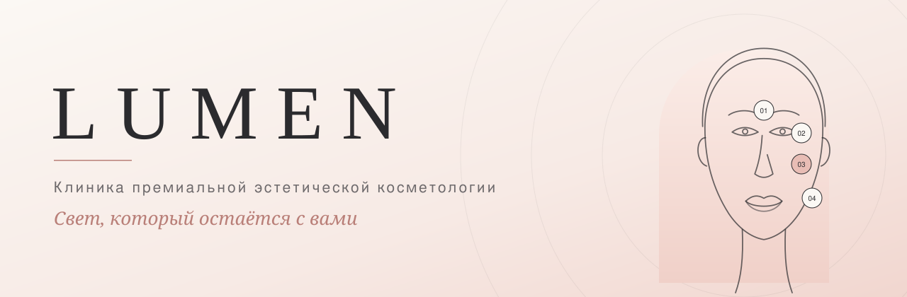

  

<h3 align="center">Свет, который остаётся с вами</h3>

  Авторский одностраничный сайт клиники эстетической косметологии: продуманный дизайн, интерактивная «Карта красоты», слайдер «До / После» и плавные CSS-анимации. Выполнен в одном файле без фреймворков и сторонних библиотек.

  <a href="https://lumen-production-1ccb.up.railway.app"><b>Открыть живую версию →</b></a>

  
  
  
  

---

## О проекте

**LUMEN** — кастомный концепт сайта для клиники премиальной эстетической косметологии. Проект спроектирован с нуля с акцентом на премиальную визуальную подачу: много свободного пространства, мягкая цветовая палитра, изящная типографика и выверенная микродинамика элементов.

> Это концептуальный проект. Названия, цены, контакты и данные лицензии указаны в качестве демонстрации.

## Архитектура и функционал

| Блок | Реализация |
|---|---|
| **Карта красоты** | Интерактивный векторный интерфейс лица с шестью ключевыми зонами (лоб, контур глаз, скулы, губы, овал, шея). При наведении или клике с любого устройства динамически обновляется описание и список процедур с возможностью быстрой записи. |
| **Услуги** | Кастомный таб-переключатель категории («Инъекции», «Аппаратная косметология», «Уход») со скользящим индикатором. Карточки фильтруются через анимацию прозрачности и трансформации. |
| **До / После** | Слайдер сравнения результатов на чистом JS: поддерживает перетаскивание мышью, touch-жесты на смартфонах и навигацию с клавиатуры (`←`, `→`, `Home`, `End`). |
| **Форма записи** | Интерактивные поля с плавающими labels, встроенная маска ввода телефона `+7 (XXX) XXX-XX-XX`, валидация данных и автовыбор услуги. |
| **Навигация** | Адаптивная шапка с эффектом матового стекла (backdrop-blur) при прокрутке. Мобильное меню с раскрытием по круговой маске. |
| **Производительность** | Появление элементов при прокрутке реализовано через `IntersectionObserver`. Векторная графика вшита прямо в код, за счёт чего страница загружается мгновенно. |

## Дизайн-система

Авторская палитра в эстетике премиального минимализма:

| Цвет | Код | Назначение |
|---|
